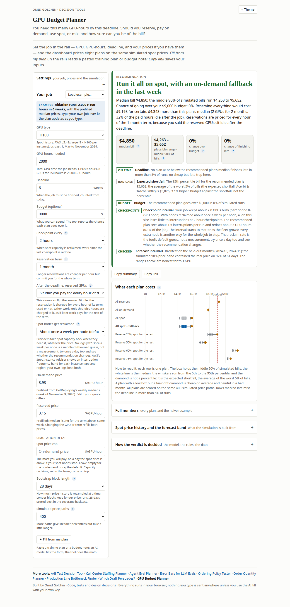

# GPU Budget Planner

For ML engineers and lab managers planning a training run: enter the GPU-hours you need and your deadline, and get a concrete buying plan (reserve, pay on demand, use spot, or a mix) with the median bill, the plausible range, and the chances of going over budget or finishing late.



**Use it:** https://omidgolchin.github.io/gpu-budget-planner/ (runs in your browser; nothing you type leaves it)

## What it does

- One job: "I need this many GPU-hours by this deadline. Should I reserve, pay on demand, use spot, or mix, and how sure can I be of the bill?"
- Eight plans are priced on the same simulated spot-price paths: all reserved, all on-demand, all spot, all spot with an on-demand fallback in the last week, and four reserve/spot mixes (25/50/60/75% reserved).
- Spot prices are simulated by block bootstrap (28-day blocks) of real daily price changes, so multi-day price runs persist.
- Spot nodes are reclaimed for capacity, whatever the price, at a rate you set (from once a month to several times a day per node). A training job that runs its nodes in lockstep stops when any one goes, so each reclaim throws away half a checkpoint interval of the whole fleet's work. Plans without a fallback can finish late, and the verdict says how often.
- A reservation is a commitment: whole GPUs for whole terms, paid whether or not the job still needs them, unless you say the GPUs go on to other work after the deadline.
- Prices are prefilled from current market data (GetDeploying medians) and the spot history is real (AWS spot archive); every price is editable, because your quote beats a median.
- The "Fill from my plan" assist reads a pasted plan or budget note and fills the form with your own API key (or a copy-prompt fallback). Every filled value shows the phrase it came from; the model never computes the verdict.

## Built-in checks

| Check | What it does |
|---|---|
| Deadline (late risk) | Flags any plan at or below the winner's median that finishes late in more than 5% of runs, and draws "late N%" on its chart row |
| Expected shortfall | Shows the average of the worst 5% of bills beside the 95th percentile (Acerbi & Tasche 2002), and warns when it exceeds your budget |
| Budget | Reports the winner's chance of going over budget; if even the cheapest fixed-price plan exceeds the budget, the verdict says the budget cannot be met |
| Checkpoint interval | States the fleet size (GPUs, 8-GPU nodes), the expected reclaims and redone GPU-hours for the recommended plan, and re-runs it with hourly checkpoints to say whether the winner or its median changes |
| Forecast intervals | Backtests the simulated 90% price band on two held-out months per GPU and shows pass or warning (H100 92%, A100 72%, V100 48% of days covered) |

## Design decisions

- **Block bootstrap, not day-by-day resampling** (Politis & Romano 1994): shuffling single days breaks up the price runs that cause interruptions. The i.i.d. comparison is shown in Full numbers.
- **Block length 28 days**, picked from a backtest sweep (7/14/28/45) and then reported honestly: coverage still warns on two of three GPUs, and the page says so rather than tuning the warning away.
- **The spot level is anchored, the dynamics are archival.** The AWS archive's prices are from 2024, so each series is multiplied by one constant that sets its last-30-day median to GetDeploying's current spot median. Returns, runs and the coverage backtest are unaffected by a constant scale.
- **Interruptions come from capacity, not price.** Since late 2017 AWS has not interrupted spot instances over competing bids, and prices move slowly; nodes are reclaimed when EC2 needs the capacity back. The first version modeled interruptions only as the price crossing your cap, which on these series almost never happens, so the checkpoint check always said "interruptions are rare". Now each running node is reclaimed at a constant rate (per node-hour), daily counts are Poisson drawn from one uniform per day shared by all plans, and each reclaim costs the lockstep fleet half a checkpoint interval: a uniform interruption point in the cycle. The price cap stays as a second, optional mechanism.
- **A reservation is charged as a commitment.** Enough whole GPUs to do the reserved share by the deadline, paid for every hour of every term needed to cover it. The first version charged reserved GPUs only for the hours used, which made a 12-month reservation look like the cheapest way to run a 6-week job. The "go to other work" option restores per-hour charging for teams that will use the capacity afterwards.
- **Near ties go to the plan that finishes on time.** Bills within 0.5% of the cheapest count as a tie, won by the plan least likely to finish late: all-spot and all-spot with a fallback often cost the same, and only one of them can miss the deadline.
- **Feasibility before price:** a plan must finish on time in at least 95% of runs to win; with a budget, plans over budget in at most 20% of runs are preferred; a fixed-price plan within 2% of the cheapest risky plan wins as the sure thing.
- **The reference engine is Python; the page mirrors it** function for function, including the seeded RNG, and a test keeps them in exact agreement.

## Validation

- **25 tests** (`make test`): every strategy's cost equals the hand calculation when volatility is zero; block bootstrap preserves the mean price change; interruption cost equals hand-computed lost work on a fixed path; capacity reclaims match rate × node-hours run (within 3% over 400 paths) and cost between one and three fleet-half-intervals each; the Poisson inverse transform's mean; weekly checkpoints costing 20% more than hourly ones on a big lockstep job with daily reclaims; reservation cost as a whole-GPU, whole-term commitment on hand-computed cases; checkpoint frequency flips the winning strategy on a constructed series; all five verdict rules fire; expected shortfall on known numbers; coverage is exact (1.0 and 0.0) on constructed series; the JavaScript and Python engines agree on four cases (one with reclaims and a 1-month term) to 1e-9, RNG stream bit-exact; the assist's prompt, parsing and quote checks.
- **Coverage backtest** (walk-forward, October and November 2024 held out): H100 56 of 61 days (92%), A100 44 of 61 (72%), V100 29 of 61 (48%). The two warnings are shown on the page, not hidden.
- **AI extraction: not yet run.** The 20-item test set is in `assist/testset.json`; score a model with `scripts/eval_assist.js` (needs a key in an environment variable, nothing is sent by the tests).
- Checked on desktop (1366px) and phone (390px) widths with no console errors and no sideways scroll; every example loads and reaches its verdict state.

## What I learned

- AWS spot is not automatically the cheap option. In us-east-1 the H100 spot price sat above today's cross-provider on-demand median for much of 2024, which is why the history's level is anchored to the current market before any comparison is made.
- The checkpoint interval is a property of the fleet, not the job. A 2-GPU job loses a few GPU-hours to weekly reclaims whatever its checkpoints; a lockstep job on 11 nodes reclaimed about once a day each cannot make progress on spot with 8-hour checkpoints, and with hourly ones a 60% reservation becomes the cheapest plan. My first version tied interruptions to price and found them "rare"; spot has not worked that way since 2017.
- A reservation's price per GPU-hour is not its cost. Two GPUs on a 12-month term for a 6-week job leave nine tenths of the paid hours idle; the per-hour quote hides that, and so did my first version.
- A percentile is not a budget number. The average of the worst 5% of bills sits above the 95th percentile on every plan here, and it is the number a budget actually has to survive.
- Reserving is not automatically cheaper than on-demand either: for the V100, the 12-month reserved listings in the data cost more per GPU-hour than the on-demand median, because the two are sold by different, thinner markets.

## Research notes

- Per-GPU price history from the AWS archive (levels, volatility, interruption frequency by cap): `results/data_summary.json` and `results/figures/spot_history.png`, produced by `scripts/process_data.py`.
- A forecast-method comparison for these series (seasonal naive, ETS, a pretrained time-series model, an LLM forecaster) is specced but not yet run; the coverage backtest in the tool is the first piece of it.

## Run it

Open `docs/index.html` in a browser (or serve `docs/` statically). To re-run the tests and rebuild the data:

```
python3 -m venv .venv && .venv/bin/pip install -r requirements.txt
make test          # pytest, no network, no API calls
make reproduce     # re-download both datasets and rebuild docs/data/prices.json
```

## Layout

- `docs/` the tool: `index.html`, `app.js`, `gpuplan.js` (engine), `assist-config.js`, the shared kit files, `data/prices.json` (+ `prices.js`, the same data as a script for `file://`)
- `src/gpubudget/` the Python reference engine and the coverage backtest
- `tests/` engine, coverage, JS-agreement and assist tests
- `assist/testset.json` 20 realistic plan messages with the fields they state
- `scripts/` `download_data.py` (both sources), `process_data.py` (builds the page data), `eval_assist.js` (shared assist scorer)
- `data/raw/` the downloads: filtered AWS spot extracts and the GetDeploying CSVs
- `results/` data summary and the spot-history figure

## Limitations

- Daily granularity: work is spread evenly over the deadline and reclaims are counted per day. Real jobs ramp, pause and checkpoint unevenly, and a reclaimed node can take hours to replace; that wait is not modeled.
- The reclaim rate is one number you choose, constant over the job. Real reclaim rates vary by instance type, region and hour, and cluster in time.
- One region and one instance family per GPU (us-east-1; p5/p4d/p3). Spot markets differ by region.
- Reserved prices are per-GPU-hour listing medians, charged per whole GPU for whole terms; real reservations come in node-sized blocks on some clouds and single GPUs on others.
- The price dynamics are May to November 2024 (the archive's coverage); the level is November 2026's. A regime change in spot markets is not in either.
- V100 reserved listings are thin (a handful of providers), so its reserved prefills are noisy; they are shown as the data states them.

## References

- Acerbi, C. & Tasche, D. (2002). On the coherence of expected shortfall. *Journal of Banking & Finance* 26(7).
- Politis, D. N. & Romano, J. P. (1994). The stationary bootstrap. *Journal of the American Statistical Association* 89(428).
- Pauley, E. (2024). AWS Spot Price History [data set]. Zenodo. https://doi.org/10.5281/zenodo.14254112 (CC BY 4.0)
- GetDeploying (2026). GPU rental price history [data set]. https://getdeploying.com/dataset/gpu-prices (CC BY 4.0)

## Citation and license

MIT (see `LICENSE`). If you use the engine or the processed data, please cite this repository (see `CITATION.cff`) and the two datasets above.
